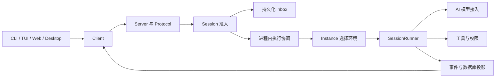

# OpenCode 中文代码库分析

开源 AI 编程代理，以 Bun 和 TypeScript 工作区组织持久会话执行核心、模型与工具能力、HTTP 服务、终端、Web 和 Electron 桌面界面，并提供 GUI 扩展、嵌入式 SDK 与独立分发服务。

分析提交：`57e0614a5eb2acd08bb23e50b09ea9362168168d`；生成时间：2026-10-14T15:52:06.564Z。输出语言：简体中文。

覆盖 **7191/7191 个文件**，生成 **15038 个节点、36414 条关系、10 个架构层和 15 步导览**。
本次涉及 5904 个新增或变更文件；1287 个未变文件在复用前通过内容指纹核验。366 个批次共带入 6964 个文件，其余 227 个未变文件直接保留。

## 从入口到一次模型调用

`packages/cli/src/index.ts` 使用 Effect 命令框架和延迟导入选择命令。TUI、Web 与桌面界面通过客户端接口调用服务。Schema 定义共享数据，Protocol 定义 HTTP 与事件契约，Server 绑定领域处理器；Client 只需要 Schema/Protocol 的运行时契约，SDK 进一步组合客户端与可嵌入服务。

`Session.prompt` 先准入 durable inbox，再请求进程内执行协调器唤醒。交付时将 inbox 消费与可见消息写入放在同一投影事务。执行模块读取 Session，再由 `Instance.Service.provide(session)` 选择环境能力；Runner 组织模型请求与工具执行，每次物理尝试有显式的 `llm.stream` 调用。

## 关键概念

- **准入和执行分开**：输入已接受不代表已经出现在模型可见历史；steer 和 queue 在不同边界交付。
- **重试采用首次准入结果**：用户和合成输入 ID 在 Session、类型相符时幂等，已交付输入可从消息投影恢复身份。
- **执行协调属于当前进程**：同一会话的请求协调到同一执行链，不同会话可以并发。durable claim 用于重启恢复，不代表集群所有权。
- **历史驱动继续执行**：逻辑 Step 与物理尝试不同；继续时从持久化历史恢复，避免仅靠内存工具循环推进。
- **指令由领域产生、会话保存**：Instructions 组合来源，InstructionState 与 History 保存值、epoch 和历史更新；当前实现没有旧版 SystemContext Registry。
- **扩展与宿主通过契约交互**：GUI 扩展通过 SDK 契约、IPC、注册表和存储访问宿主；App 组织数据与交互，session-ui 负责共享消息呈现。
- **发布服务单独部署**：files 服务负责 R2 公共下载，update 服务选择渠道制品和渐进更新，www 服务提供新的 Astro 文档站。

## 架构层

- **共享数据契约与协议**（137 个文件级节点）：Schema 定义共享领域数据，Protocol 定义 HTTP 与事件接口，为 Core、Server 和 Client 提供可校验的公共契约。
- **会话核心与模型执行**（732 个文件级节点）：Core 管理会话准入、持久事件、执行协调、指令历史、工具与权限，AI、CodeMode 和共享运行工具提供模型接入与受控执行能力。
- **服务端 API 与事件分发**（53 个文件级节点）：Server 装配 Protocol 的请求处理器、认证、事件流与进程或嵌入入口，并连接 Core 领域服务与恢复生命周期。
- **终端、桌面与共享界面**（1483 个文件级节点）：CLI、TUI、Web App 与 Electron 提供用户入口，session-ui、UI、主题、图表和公式包提供共用呈现与交互能力。
- **GUI 扩展与窗口宿主**（850 个文件级节点）：GUI 扩展实现浏览器、终端、文件预览和更新等功能，通过 SDK 契约、IPC、注册表与存储连接 App 窗口扩展宿主。
- **客户端 SDK 与外部集成**（129 个文件级节点）：Client 提供契约驱动的 Promise、Effect 与 Solid 接口，SDK 组合嵌入式服务，插件、浏览器与外部集成暴露扩展边界。
- **云端控制台与站点服务**（696 个文件级节点）：Console、Stats、企业与分享站点承载云端功能，独立 files、update 和 www 服务提供下载分发、更新选择和文档站运行。
- **测试与验证**（1864 个文件级节点）：包内测试、录制夹具、组件故事、性能场景、simulation 与 HTTP 录制工具验证跨层行为、协议适配和界面状态。
- **工程配置、基础设施与发布**（461 个文件级节点）：工作区清单、构建与生成脚本、CI/CD、容器、基础设施和发布工具组织仓库检查、制品生成及部署。
- **文档与设计规范**（828 个文件级节点）：README、开发约定、多语言用户文档、设计规范与学习笔记解释产品使用、架构决策和协作流程。

## 推荐阅读路径

1. **认识产品与工作区**：先从 README 理解 OpenCode 的 AI 编程代理用途，再看根清单如何组织 Bun 工作区。会话核心、服务器、终端和桌面界面分包演进；后续导览沿着一次用户输入经过的边界展开。
   [README.md](../README.md) · [package.json](../package.json)

2. **命令入口与延迟装配**：CLI 入口把 Effect 命令树交给 Runtime 执行，具体处理器在命令被选择后才加载。默认命令连接服务器并启动 TUI，因此命令行参数、服务连接和交互界面分别有自己的职责。
   [packages/cli/src/index.ts](../packages/cli/src/index.ts) · [packages/cli/src/commands/commands.ts](../packages/cli/src/commands/commands.ts) · [packages/cli/src/framework/runtime.ts](../packages/cli/src/framework/runtime.ts) · [packages/cli/src/commands/handlers/default.ts](../packages/cli/src/commands/handlers/default.ts)

3. **公共契约到 HTTP 服务**：共享 Schema 定义会话等领域数据，Protocol 用这些数据声明 HTTP 与事件接口。Server 汇总契约并组合处理器，再把请求交给 Core；Client 的运行时契约来自 Schema 和 Protocol，这一方向也约束客户端生成。
   [packages/schema/src/session.ts](../packages/schema/src/session.ts) · [packages/protocol/src/api.ts](../packages/protocol/src/api.ts) · [packages/server/src/api.ts](../packages/server/src/api.ts) · [packages/server/src/handlers.ts](../packages/server/src/handlers.ts) · [packages/client/README.md](../packages/client/README.md)

4. **先准入，再交付输入**：Session.prompt 先持久接纳输入，再按 resume 选项唤醒执行。inbox 只保存尚未交付的工作；交付事件在同一投影事务内消费 inbox 并写入可见消息。同 Session、同类型的用户或合成输入 ID 重试采用首次准入结果，避免重复输入。
   [packages/core/src/session/session.ts](../packages/core/src/session/session.ts) · [packages/core/src/session/inbox.ts](../packages/core/src/session/inbox.ts) · [packages/core/src/session/event.ts](../packages/core/src/session/event.ts) · [packages/core/src/session/projector.ts](../packages/core/src/session/projector.ts)

5. **执行协调与重启恢复**：SessionExecution 和 RunCoordinator 以 Session ID 在当前进程内协调 resume、wake 与中断。drain 开始时读取会话，再通过 Instance 服务取得环境能力；持久 claim 保留需在重启后恢复的执行事实。服务启动恢复这些 claim，它不构成集群所有权或恰好执行一次的保证。
   [packages/core/src/session/execution.ts](../packages/core/src/session/execution.ts) · [packages/core/src/session/run-coordinator.ts](../packages/core/src/session/run-coordinator.ts) · [packages/core/src/instance/service.ts](../packages/core/src/instance/service.ts) · [packages/server/src/process.ts](../packages/server/src/process.ts)

6. **逻辑步骤与物理尝试**：Runner 在安全边界选择输入并装配历史，一次逻辑 Step 可以包含重试或续接。step.ts 对每次物理尝试显式调用 llm.stream，并把模型输出和工具结果写回持久历史。AI 层统一模型协议与流式能力，让 Core 保持执行策略的所有权。
   [packages/core/src/session/runner/llm.ts](../packages/core/src/session/runner/llm.ts) · [packages/core/src/session/runner/step.ts](../packages/core/src/session/runner/step.ts) · [packages/ai/src/llm.ts](../packages/ai/src/llm.ts) · [packages/ai/src/route.ts](../packages/ai/src/route.ts)

7. **指令历史与上下文压缩**：Instructions 组合领域产生的指令，Discovery 观察环境来源，Session 的 InstructionState 保存内容哈希与基线。后续指令变化进入可重放历史，压缩则调整上下文和指令 epoch。SessionCompaction 选择摘要或模型原生压缩，统一处理中断、重试、用量和检查点。
   [packages/core/src/instructions/index.ts](../packages/core/src/instructions/index.ts) · [packages/core/src/instruction-discovery.ts](../packages/core/src/instruction-discovery.ts) · [packages/core/src/session/instruction-state.ts](../packages/core/src/session/instruction-state.ts) · [packages/core/src/session/history.ts](../packages/core/src/session/history.ts) · [packages/core/src/session/compaction.ts](../packages/core/src/session/compaction.ts)

8. **工具执行与能力边界**：模型产生的工具请求进入工具运行时，由权限服务和插件契约决定可用能力与执行方式。CodeMode 在受限 JavaScript 解释器中组合工具，并显式处理宿主值、资源限制和异常。这里把模型提出的操作转换成可控制、可观察的领域行为。
   [packages/core/src/tool/runtime.ts](../packages/core/src/tool/runtime.ts) · [packages/core/src/permission.ts](../packages/core/src/permission.ts) · [packages/codemode/src/codemode.ts](../packages/codemode/src/codemode.ts) · [packages/plugin/src/effect/plugin.ts](../packages/plugin/src/effect/plugin.ts)

9. **客户端与嵌入式 SDK**：Client 把服务器契约投影为 Promise、Effect 等调用表面，成为终端与 Web 界面的公共入口。SDK 进一步组合 Client、Core 和 Server，在进程内直接执行装配好的路由，并管理插件与关闭生命周期。阅读 SDK 文档可分清远程连接和嵌入宿主这两种使用方式。
   [packages/client/src/promise/index.ts](../packages/client/src/promise/index.ts) · [packages/sdk/src/internal/host.ts](../packages/sdk/src/internal/host.ts) · [packages/sdk/README.md](../packages/sdk/README.md)

10. **会话数据如何成为界面**：Web App 装配多服务器环境，再由会话模型与屏幕绑定当前路由、输入框、请求面板和时间线。MountedSession 固定一次挂载的身份，SessionScreen 承接该会话的界面动作。session-ui 从消息构造共享文档视图，使数据获取和消息呈现能够分别演进。
   [packages/app/src/app.tsx](../packages/app/src/app.tsx) · [packages/app/src/session/model.ts](../packages/app/src/session/model.ts) · [packages/app/src/session/screen.tsx](../packages/app/src/session/screen.tsx) · [packages/session-ui/src/document.ts](../packages/session-ui/src/document.ts)

11. **GUI 扩展连接宿主**：窗口扩展宿主加载并管理扩展依赖与生命周期，host-apis 将界面能力暴露给扩展。GUI 包通过 Contract、Ipc、Registry 和 Store 声明交互边界，主进程与渲染进程分别装配入口。浏览器、终端和文件预览因此可以按需加载，又共享一致的宿主协议。
   [packages/app/src/runtime/extension/host.tsx](../packages/app/src/runtime/extension/host.tsx) · [packages/app/src/runtime/extension/host-apis.tsx](../packages/app/src/runtime/extension/host-apis.tsx) · [packages/gui-extensions/src/sdk/index.ts](../packages/gui-extensions/src/sdk/index.ts) · [packages/gui-extensions/src/main.ts](../packages/gui-extensions/src/main.ts) · [packages/gui-extensions/src/renderer.ts](../packages/gui-extensions/src/renderer.ts)

12. **终端组件与语义主题**：TUI 用 OpenTUI 和 Solid 组合真实生产组件，主题解析把语义角色转换成可显示颜色。反馈、动作和表单字段拥有各自的 token，避免组件依赖某一套配色。storybook 以本地夹具展示这些组件的状态与键盘操作，可直接用于界面探索。
   [packages/tui/src/app.tsx](../packages/tui/src/app.tsx) · [packages/theme/src/tui/schema.ts](../packages/theme/src/tui/schema.ts) · [packages/theme/src/tui/resolve.ts](../packages/theme/src/tui/resolve.ts) · [packages/tui/src/feature-plugins/system/storybook/index.tsx](../packages/tui/src/feature-plugins/system/storybook/index.tsx)

13. **云端功能与分发服务**：Console 的账单领域和 Stats 同步服务展示了代理运行之外的云端能力。独立 files 服务处理公共下载，update 服务按渠道、版本和渐进发布条件选择更新制品。它们拥有独立部署边界，阅读时需要与本地会话服务区分。
   [packages/console/core/src/billing.ts](../packages/console/core/src/billing.ts) · [packages/stats/server/src/stat-sync.ts](../packages/stats/server/src/stat-sync.ts) · [services/files/src/index.ts](../services/files/src/index.ts) · [services/update/src/index.ts](../services/update/src/index.ts)

14. **验证行为与契约生成**：测试流水线与检查流水线覆盖包级行为、类型和工程约束，HTTP 录制器支持真实传输的可重复验证。Client 生成脚本从 Server HttpApi 派生客户端表面，因此公共协议改变后应重新生成并检查结果。测试、故事和夹具在图谱中保留独立层，便于沿依赖寻找验证入口。
   [.github/workflows/test.yml](../.github/workflows/test.yml) · [.github/workflows/check.yml](../.github/workflows/check.yml) · [packages/http-recorder/src/index.ts](../packages/http-recorder/src/index.ts) · [packages/client/script/build.ts](../packages/client/script/build.ts)

15. **从源码到发布产物**：最后查看服务说明、CLI 容器和发布工作流，理解代码如何成为安装包与可部署服务。独立更新服务有自己的部署流程，文档站也随服务目录演进。由此把前面的运行链与构建、检查和交付链连接起来。
   [services/README.md](../services/README.md) · [packages/cli/Dockerfile](../packages/cli/Dockerfile) · [.github/workflows/publish.yml](../.github/workflows/publish.yml) · [.github/workflows/deploy-update.yml](../.github/workflows/deploy-update.yml)

## 文件类别

| 类别 | 数量 |
| --- | ---: |
| 基础设施 (infra) | 36 |
| 代码类（含少量资源） (code) | 5348 |
| 配置 (config) | 677 |
| 文档 (docs) | 828 |
| 标记与样式 (markup) | 193 |
| 脚本 (script) | 7 |
| 数据与迁移 (data) | 102 |

## 节点类别

| 类别 | 数量 |
| --- | ---: |
| 文件 (file) | 5548 |
| 函数 (function) | 7273 |
| 类与接口 (class) | 532 |
| 服务与容器阶段 (service) | 21 |
| 流水线 (pipeline) | 28 |
| 表与迁移 (table) | 125 |
| 配置 (config) | 683 |
| 文档 (document) | 828 |

## 关系类别

| 关系 | 数量 |
| --- | ---: |
| imports (imports) | 19523 |
| tested_by (tested_by) | 2058 |
| contains (contains) | 7818 |
| exports (exports) | 4722 |
| related (related) | 754 |
| calls (calls) | 1356 |
| deploys (deploys) | 6 |
| triggers (triggers) | 2 |
| defines_schema (defines_schema) | 17 |
| documents (documents) | 100 |
| configures (configures) | 52 |
| migrates (migrates) | 6 |

## 验证与分析边界

图谱通过插件 KnowledgeGraph Schema、文件覆盖、路径存在性、实际源码行号范围、节点与关系唯一性、关系目标、分层归属和导览引用校验；扫描器给出的全部内部导入都经过完整性检查。修正了一处 Docker 阶段的末尾空行范围，并对扫描器末行计数差异使用实际源码核验。

另以 TypeScript AST 和工作区清单补充 7194 条真实导入关系，覆盖包导出别名、条件实现和字面量动态导入。类型引用、可选宿主实现与运行时调用含义不同，条件导出不能理解为所有分支同时运行。

仍有 9 条引用不建边：5 条音频资源按既有忽略配置排除，4 条 packages/web 旧类型引用没有当前包清单导出。没有为这些引用创建不存在的文件节点。生成客户端的机械端点保留文件节点；Effect.fn 的关键生成器入口已按源码补充，但静态图谱不承诺枚举所有动态行为。

独立节点共 1206 个，通常是未被直接导入的文档、资源、配置或测试夹具。保留这些节点可维持完整文件清单；没有为消除独立节点而虚构调用关系。

分批工具记录了 61 条大依赖群拆分或邻居上下文上限提示。它们影响分析批次的组织；完整 importMap 仍参与最终校验。分析代理多次因账户用量限制中断，最后由主任务接管并复用已保存产物完成。初次扫描误纳入分析自身产物、接口批次遗漏范围外邻居，以及合并器忽略 batch-existing.json 和跨类别导入的问题均已修复；没有跳过批次。

图谱表示静态结构与经源码核对的关系，不承诺覆盖所有动态运行路径。部分旧 README 已落后于当前目录，例如 Stats 的旧 function 路径；本导览使用实际存在的 app/core/server 文件。

完整机器可读结果见 [knowledge-graph.json](knowledge-graph.json)；计数、阶段记录与警告见 [analysis-report.json](analysis-report.json)。

## 本地交互面板

面板已作为本机后台进程启动，HTTP 返回的提交、节点和关系数量与保存图谱一致，浏览器已显示完整的 15 步中文导览。当前访问地址保存在 `dashboard.knowledge.session.json`。

启动过程中已解决配置加载模式、沙箱回环连接和终端进程生命周期问题；配置打包仍提示仓库未安装 `@tsconfig/bun`，不影响本次已验证的面板显示。
